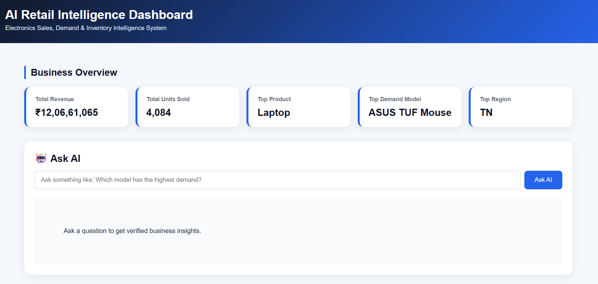
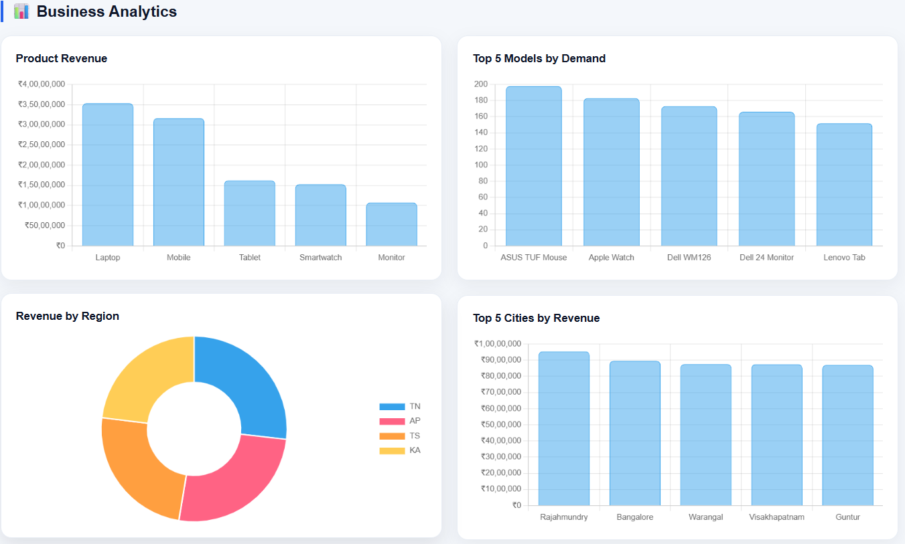
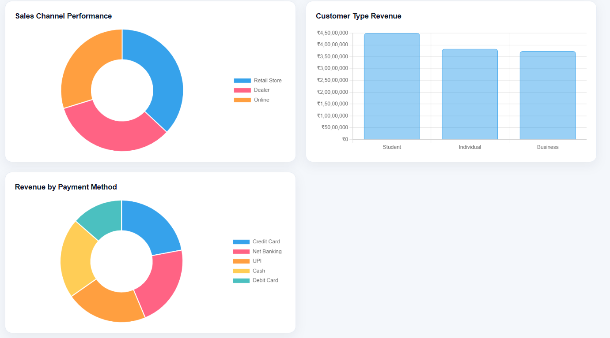
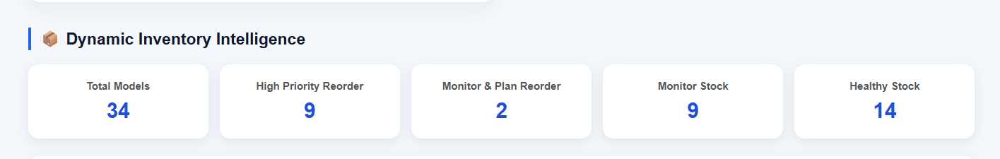

# AI Retail Intelligence & Decision Support System

## 🚀 Live Demo

[Click here to view the AI Retail Intelligence System](https://ai-retail-intelligence-system.onrender.com)

An AI-powered retail analytics system designed to analyze electronics sales, understand inventory levels, and estimate next-month product demand.

## Project Overview

This project helps users explore electronics sales data through an interactive dashboard and a locally running AI assistant. It provides business insights, inventory recommendations, and demand forecasts.

## Key Features

- **Business Overview:** Displays total revenue, units sold, and key business metrics.
- **AI Assistant:** Answers questions about sales data using Llama 3.2 through Ollama.
- **Business Analytics:** Analyzes sales by product, region, city, customer type, sales channel, and payment method.
- **Inventory Intelligence:** Identifies products that need stock monitoring or replenishment.
- **Demand Forecasting:** Estimates next-month product demand.
- **Interactive Dashboard:** Presents business information through charts, KPI cards, and tables.

## 📸 Project Screenshots

### Business Overview


### Business Analytics




### Dynamic Inventory Intelligence


## Technologies Used

- Python
- FastAPI
- Pandas
- NumPy
- Scikit-learn
- HTML, CSS, JavaScript
- Chart.js
- Ollama
- Llama 3.2

## Project Structure

```text
AI_Data_Analyst_Agent/
│
├── data/
│   └── electronics_sales_data.csv
│
├── templates/
│   └── index.html
│
├── agent.py
├── server.py
├── analyze_data.py
├── visualize_data.py
├── create_dataset.py
├── verify_dataset.py
├── requirements.txt
├── README.md
└── .gitignore
```

## Dataset

The project uses a sample electronics sales dataset containing 500 records and 18 columns.

It includes information such as:
- Order details and dates
- Product and product model
- Region and city
- Units sold and revenue
- Current stock and discounts
- Customer type and sales channel
- Payment method and order status

**Note:** The dataset is for demonstration and analysis purposes.

## Installation and Setup

### 1. Clone the repository

```bash
git clone https://github.com/bhargavi0508/AI-Retail-Intelligence-System.git
cd AI-Retail-Intelligence-System
```

### 2. Create a virtual environment

```bash
python -m venv .venv
```

### 3. Activate the environment

Windows PowerShell:

```powershell
.\.venv\Scripts\Activate.ps1
```

### 4. Install dependencies

```bash
pip install -r requirements.txt
```

### 5. Set up Ollama

Install Ollama and download the Llama 3.2 model:

```bash
ollama pull llama3.2
```

### 6. Run the application

```bash
python -m uvicorn server:app --host 127.0.0.1 --port 8000
```

Open the dashboard:

http://127.0.0.1:8000

## API Endpoints

| Method | Endpoint | Purpose |
|---|---|---|
| GET | `/` | Opens the dashboard |
| POST | `/ask` | Sends questions to the AI assistant |
| GET | `/kpis` | Returns business KPI information |
| GET | `/analytics` | Returns sales analytics |
| GET | `/inventory` | Returns inventory intelligence |

API documentation:

http://127.0.0.1:8000/docs

## Limitations

- Demand forecasts are estimates, not guaranteed future sales.
- Inventory recommendations are based on the available dataset.
- The sample dataset does not contain product cost information, so profit calculations are not included.
- AI responses depend on the available data and local language model.

## Author

**Bhargavi**

B.Tech Student | Artificial Intelligence